# DECKARD

DECKARD is a groovebox for your computer that works like NI's Maschine: scenes and
patterns, a song arrangement, sixteen pads per group, a sampler, drum synths, effects
and a mixer. It opens Maschine projects and saves them in Maschine's own format, so you
can move between the two. It can also be played from a Maschine MK3 controller or a
Novation Launchpad Pro MK3.

DECKARD also does a few things Maschine doesn't:

- **Expressive recording:** MPE, polyphonic aftertouch and pad pressure are recorded
  as curves on each note.
- **Modulation:** a mod matrix with up to 16 LFOs and envelopes per project.
- **Launchpad Pro MK3:** a session grid you can use alongside the MK3.
- **Two synths of its own:** Replicant and Plaits.
- **Custom themes** for the MK3's screens, which anyone can write.

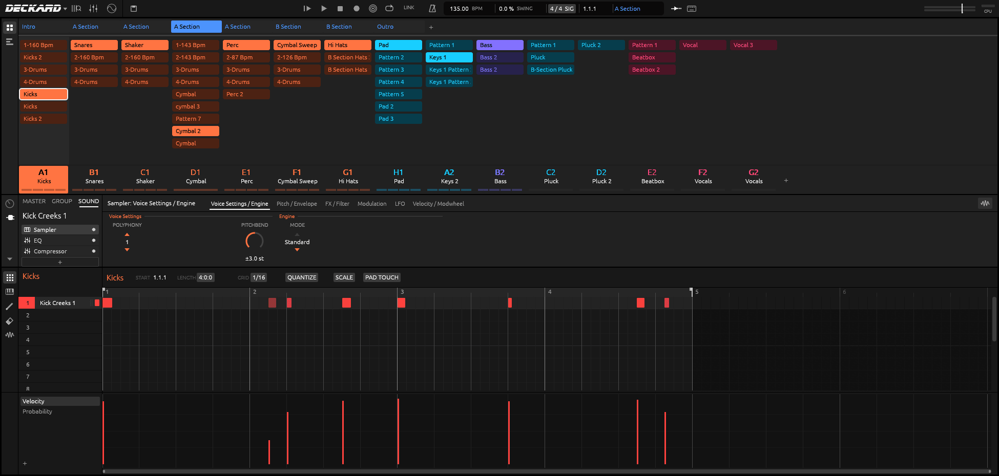

## What you need

- **A computer** running macOS, Linux or Windows.
- **Speakers or headphones.** DECKARD uses your system's audio output.
- **Optional: a Maschine MK3.** DECKARD drives its pads, buttons, knobs, lights and
  both screens directly.
- **Optional: a Novation Launchpad Pro MK3**, connected over USB.
- **Optional: Maschine and its libraries.** Maschine projects use samples, kits and
  expansions from NI's libraries. DECKARD finds the ones you have installed and plays
  them, but it doesn't come with any. Without them DECKARD still works: you can use your
  own samples and DECKARD's built-in instruments.

## Getting DECKARD

1. Download the build for your system from the
   [releases page](https://github.com/summitt/deckard/releases):
   - **macOS:** `DECKARD-<version>-macos-universal.zip`, which holds `DECKARD.app` and
     runs on both Apple Silicon and Intel Macs.
   - **Linux:** the `.deb` (Debian, Ubuntu, Mint) or `.rpm` (Fedora, openSUSE) package,
     which installs the program, its menu entry and icon, the `.mxprj` file type and
     the udev rule that lets you use the MK3 without root; or
     `deckard-<version>-linux-<arch>.tar.gz`, which holds the same files for you to
     place yourself.
   - **Windows:** `DECKARD-<version>-windows-x64.zip`.
2. Install it.
   - **macOS:** unzip it and move DECKARD.app to Applications.
   - **Linux:** `sudo apt install ./deckard_<version>-1_amd64.deb` or
     `sudo dnf install ./deckard-<version>-1.x86_64.rpm`. With the tarball instead,
     unpack it and copy the udev rule into `/etc/udev/rules.d/` if you use an MK3.
   - **Windows:** unzip it.
3. Start DECKARD. It opens the project you had open last, or a new empty one. The
   first time, it offers to download the stem separation model (84 MB); you can also
   leave that until you first use STEMS.

If you build DECKARD yourself, the packages end up in the `dist/` folder of your
checkout. [DEVELOPMENT.md](DEVELOPMENT.md) explains how.

### Opening and saving projects

- **Opening:** use **File ▸ Open…**, pick from **File ▸ Open Recent**, or drag a
  Maschine project (`.mxprj`) onto the window. Samples (WAV and other audio files)
  dropped onto a sound load into it.
- **Saving:** **File ▸ Save** writes a normal Maschine project. The first time you save
  over a file in a session, the previous version is kept beside it as
  `<name>.mxprj.bak`.
- **If DECKARD closes with unsaved changes**, it brings them back from a backup the next
  time it starts.
- **Exporting:** **File ▸ Export Audio…** renders the song, or stems per group or per
  sound, to WAV files. **File ▸ Export MIDI…** writes a MIDI file.

### Using a Maschine MK3

1. **Quit Maschine and NI's hardware agents first** (NIHardwareAgent and
   NIHostIntegrationAgent). While they run, they hold on to the controller's screens.
2. Plug in the MK3. DECKARD finds it on its own.

DECKARD runs the MK3 with its own controller layer, so you don't need Maschine
installed. Its screens can be themed (see [Custom themes](#custom-themes-for-the-mk3s-screens)). You
can also change what any button or page does: **Controller ▸ Open Controller Scripts
Folder** opens a folder of editable scripts (see
[docs/controller-api.md](docs/controller-api.md)).

## A tour

### Ideas view

Above is the Ideas view:

- **Scenes** are the tabs along the top. Each group has a column of its patterns, and
  the group tiles sit at the bottom.
- **Playing:** PLAY (or Space) loops the focused scene. Clicking another scene queues
  it, and it takes over when the current one ends.
- **Editing scenes:** click a pattern to put it in the scene. Right-click a scene to
  rename, duplicate or delete it.

Below the scenes is the **Control area**, with the MASTER, GROUP and SOUND tabs and
the knobs of whatever you've picked. Below that is the **pattern editor**, with its
lanes for velocity, probability, MIDI controllers and expression.

### Song view

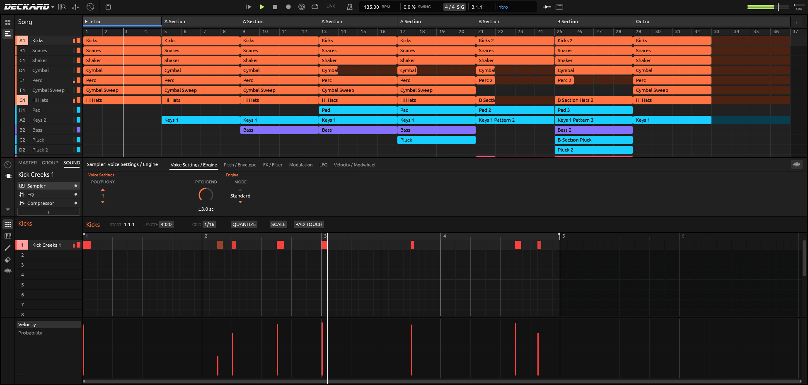

The Song view is the arrangement: one section after another, each playing a scene. You
can:

- add, move, duplicate and resize sections;
- click a section to jump there when the current one ends.

### Piano roll

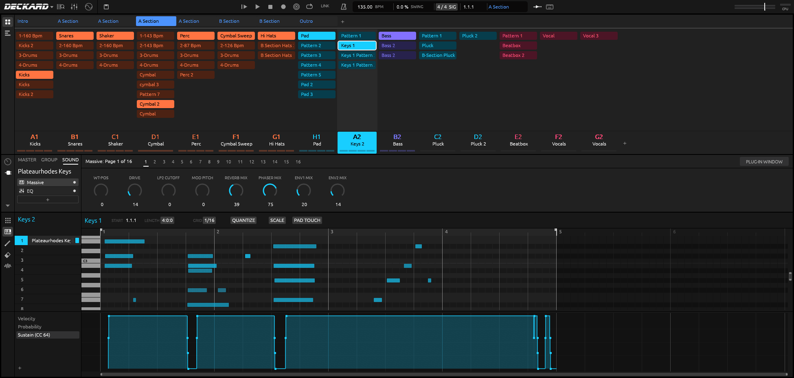

Switch the pattern editor between the drum grid and the piano roll (**View ▸ Piano
Roll**). Use the pencil to draw notes. Set GRID, QUANTIZE, LENGTH and SCALE from the
pattern header. The lane underneath shows velocity, probability (how likely a note is
to play), or any MIDI controller such as the sustain pedal or pitch bend.

### Mixer

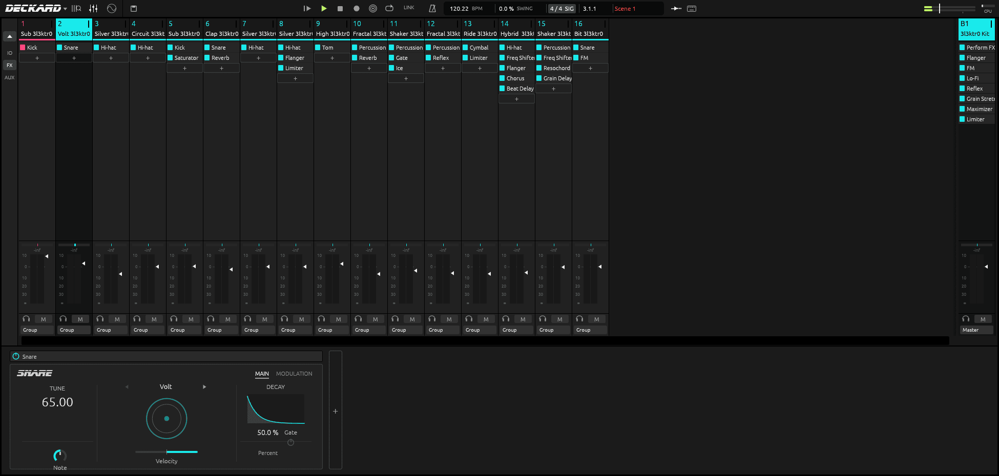

Open the mixer with the faders button in the header or **View ▸ Mixer**. Each strip
has:

- the sound's or group's chain of instruments and effects;
- pan, meters and a fader;
- cue, mute and solo.

The panel along the bottom shows the selected module's controls. Here it is DECKARD's
Snare drum synth.

### Built-in instruments and effects

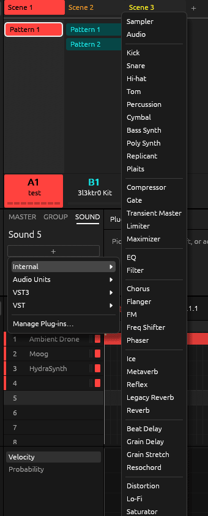

The **+** at the end of any chain opens the plug-in menu. Under **Internal** you'll
find:

- **Sampler and Audio:** the Sampler plays multi-sample zones. Audio plays loops that
  follow the tempo.
- **Drum synths:** Kick, Snare, Hi-hat, Tom, Percussion and Cymbal.
- **Synths:** Bass Synth and Poly Synth, plus DECKARD's own **Replicant** and
  **Plaits** (see below).
- **Effects:** Compressor, Gate, Transient Master, Limiter, Maximizer, EQ, Filter,
  Chorus, Flanger, FM, Freq Shifter, Phaser, Ice, Metaverb, Reflex, Reverb, Beat Delay,
  Grain Delay, Grain Stretch, Resochord, Distortion, Lo-Fi, Saturator and more.
- **Perform FX:** Filter, Flanger, Burst Echo, Reso Echo, Ring, Stutter, Tremolo and
  Scratcher. These go first in a group's chain and are played from a strip.

DECKARD's versions of Maschine's modules are its own sound engines, written to behave
like Maschine's.

 

## Recording, with expression

To record, arm with REC and press PLAY. SHIFT + REC adds a count-in. Pads, MIDI
keyboards and your computer keyboard (⌘K) all record into the playing pattern. Each
take is one undo step.

DECKARD records more of your playing than Maschine does. Each note can keep up to
four curves of its own, as in Ableton's Note Expression:

- **Pressure:** how hard you press while the note is held;
- **Slide:** the up-and-down movement of a finger on an MPE key (MIDI CC 74);
- **Pitch:** a bend of that one note;
- **Release:** how fast the key was let go.

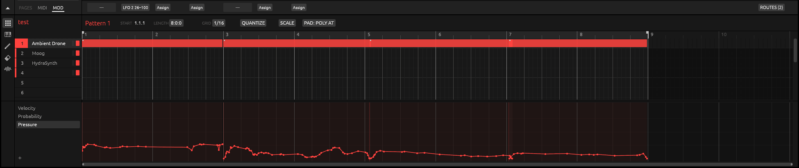

Where the expression comes from:

- **MPE controllers** (for example a Hydrasynth in MPE mode, Roli or Linnstrument
  keyboards):
  - Tick **MPE** beside the controller's input in **Preferences ▸ MIDI**.
  - Set its pitch-bend range there; the default is ±48 semitones.
  - Each note's own bend, slide and pressure are then recorded with it.
- **Polyphonic aftertouch:** a keyboard (or a Launchpad) that sends pressure per key
  records it as each note's Pressure. Nothing to set up.
- **Channel aftertouch, pitch bend and other controllers** go into the pattern's
  controller lanes ("Aftertouch", "Pitch Bend", a CC number). They overwrite while you
  move a control and stop when you let go.
- **MK3 pad pressure:** each sound has a **Pad Touch** setting. Find it in the pattern
  header (PAD TOUCH), or on the MK3's Keyboard page under its third and fourth knob
  pages. The modes are:
  - **Velocity** (the default): pressure only shapes Note Repeat;
  - **Poly AT:** each pad's pressure is recorded as that note's Pressure curve;
  - **Aftertouch:** channel pressure;
  - **CC:** a controller number of your choice.

  Curve, Min and Max shape how pressure maps to the value sent. The pressure modes play
  notes at a fixed velocity.

**Seeing and editing expression.** Once a sound's notes have expression, the lane list
under the pattern offers Pitch, Slide, Pressure and Release:

- click to add a point, drag a point or a segment, and ⌥-drag a segment to bend it;
- double-click a point to remove it, or draw freehand in draw mode;
- right-click to clear one kind of expression, or all of it, from the selected notes.

**Playing it back.**

- **To a MIDI synth:**
  - A normal MIDI output gets each note's pressure as polyphonic aftertouch, plus its
    release velocity.
  - An output marked **MPE** in Preferences ▸ MIDI gives every note its own channel
    with its bend, slide and pressure.
  - DECKARD can send the synth its MPE setup for you (**Send MPE setup to synths**, on
    by default).
- **To DECKARD's own sounds:** use Pressure, Slide and Pitch as sources in the mod
  matrix (below).
  - These routes drive the whole sound, not each voice: Pressure follows the
    hardest-pressed note, Pitch the latest one.
  - Expression isn't passed to hosted plug-ins yet.

**Saving.** Expression, LFOs and routes are saved inside the `.mxprj` in an extra block
that Maschine 3 ignores, so the project still opens in Maschine. If Maschine saves the
project again, that extra data is lost.

## Modulation: the mod matrix, LFOs and envelopes

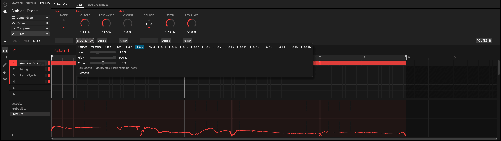

A **route** connects a source to a knob:

- **Sources:**
  - **Pressure**, **Slide** and **Pitch**, from your playing;
  - **LFO 1–16** and **envelopes**, from the LFO panel.
- **Targets:** any continuous knob in a sound's chain. That includes the Sampler, a
  drum synth, a built-in effect, Replicant, Plaits, or a hosted plug-in's parameter.
- **Depth:** each route has a **Low** and a **High**. The knob sweeps between them as
  the source moves, and setting Low above High turns it upside down. **Curve** bends
  the response.

While a route drives a knob, the knob moves on screen and on the MK3 so you can see
it. Turning the knob yourself still sets its own value.

To make a route in the software:

1. Pick a sound and a module in the Control area.
2. Open the Assignment area with the small arrow under the Control area's icons, and
   choose its **MOD** tab.
3. Click **Assign** under a knob, then pick a source and its range.

**ROUTES** at the right lists every route of the sound in one place.

### LFOs and envelopes

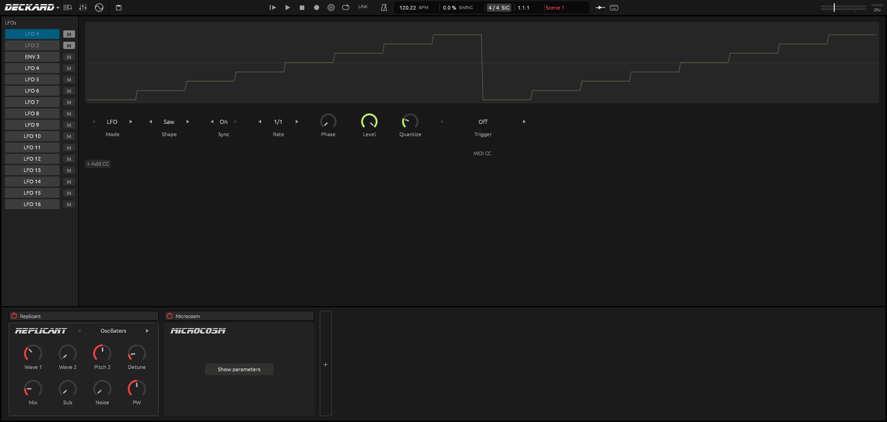

The LFO panel opens from the circle-and-sine button in the header. A project can have
up to 16 LFOs, one per pad.

- **LFO mode:**
  - Shape: Sine, Square, Triangle, Saw or Random;
  - Sync to the tempo, or a free Rate;
  - Phase, Level and Quantize, which steps the wave into stairs;
  - Trigger: a sound whose notes restart it;
  - Fade in.
- **Envelope mode:** the same slot becomes an ADSR envelope (shown as ENV n). Its
  trigger sound's notes play it, from patterns and live.
  - Attack, Decay and Release each run from 1 ms to 10 s. Sustain is the level held
    while notes are down.
  - Retrigger on or off.
- **Muting:** **M** mutes an LFO.
- **MIDI CC out:** an LFO or envelope can also be sent to external gear. The panel's
  **MIDI CC** section sends it as a MIDI controller to the port, channel and CC number
  you choose.

### On the MK3

The MK3's two screens show the LFO page (here LFO 1, a tempo-synced triangle stepped by
Quantize), the same page in Envelope mode, and the mod matrix:

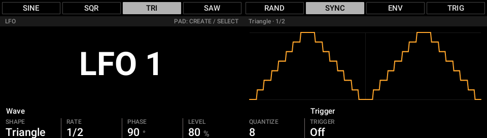

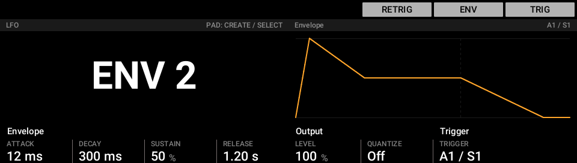

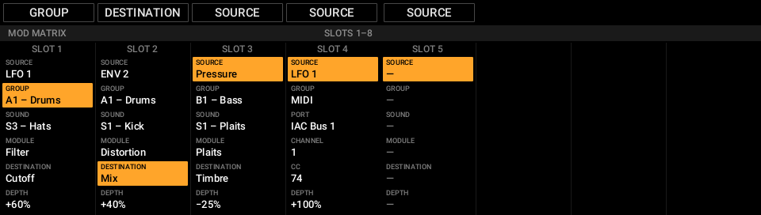

- **SHIFT + SELECT** opens the LFO page:
  - the pads pick, create, mute (MUTE + pad) and delete (ERASE + pad) LFOs;
  - the display buttons choose the shape, SYNC, ENV and the trigger;
  - knobs 1–7 set Shape, Rate, Phase, Level, Quantize, Trigger and Fade in;
  - the right-hand screen draws the wave.
- **SHIFT + SOLO** opens the mod matrix:
  - every route in the project, eight per page;
  - columns for Source, Group, Sound, Module, Destination and Depth;
  - turn a knob to change a row, ERASE + knob to remove a route, and the empty slot at
    the end to make a new one;
  - turn Group past the last group to choose **MIDI**, for an LFO-to-CC route.

Knob movements can also be recorded as automation: drag a knob while the song plays,
or switch on Auto-write (the bullseye button in the header, or AUTO on the MK3).

## Custom themes for the MK3's screens

The MK3's screens can be restyled with themes: colours, fonts and text sizes, plus an
optional animated border on the chosen button. Every page uses the theme, so one file
changes them all. Pick one in **Preferences ▸ Hardware ▸ Controller theme**.

DECKARD comes with three:

- **Maschine:** the look of Maschine's own screens.
- **Palenight:** deep blue-grey with lavender text and purple and cyan accents. A new
  install starts with it.
- **Solarized Dark.**

The same two pages in the Maschine theme (left) and Palenight (right):

| Maschine | Palenight |
|---|---|
|  | 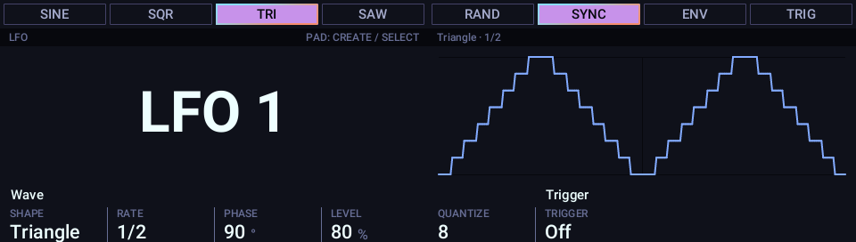 |
| 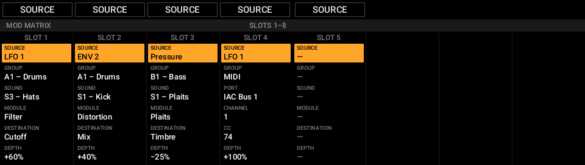 | 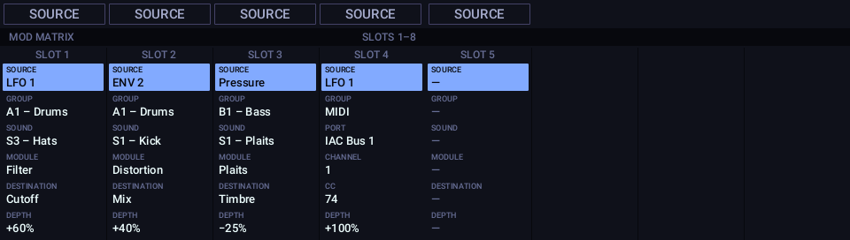 |

Making your own takes one small file: a theme only lists what it changes from another.
DECKARD reloads it as you save, so you can tweak it with the MK3 in front of you.
[THEMING.md](THEMING.md) shows how, step by step.

The DECKARD app's own window isn't themable yet.

## Launchpad Pro MK3

Plug a Launchpad Pro MK3 in over USB and DECKARD takes it over. It switches the
Launchpad to DAW mode, and the status bar says so. There's nothing to set up, and when
DECKARD quits the Launchpad goes back to standalone.

**Session mode** shows the Ideas view as a grid:

- **The grid:**
  - Each column is a group, with its patterns in the colours you gave them.
  - A pattern is bright where the focused scene plays it.
  - A pad turns its pattern on or off in the scene, and a faint pad makes a new
    pattern.
  - The bottom row is a playhead counting the bars of the longest pattern.
- **The scene buttons:**
  - The row under the grid holds the scenes: press one to launch it.
  - The playing scene pulses and a queued one flashes. A faint button makes a new
    scene.
- **The other buttons:**
  - The arrows scroll through scenes and patterns, and SHIFT + left/right moves through
    groups.
  - **Mute** mode mutes groups from their pads or scene buttons.
  - **Play** and **Record** work as on the MK3.

**Note, Chord and Sequencer modes** are the Launchpad's own. They play the focused
sound, and its pressure is recorded as polyphonic aftertouch.

- **Drums:** set a channel for the Launchpad in **Preferences ▸ MIDI ▸ Drum channel**,
  and a drum track on that channel plays the focused group's 16 pads.
- **Print to Clip:** writes the Launchpad's sequence into the focused group's pattern
  in one undoable step.
- **Tempo:** to keep the sequencer in time, send MIDI clock to the Launchpad
  (Preferences ▸ MIDI ▸ Sync).

The Launchpad is driven by an editable script, like the MK3. It has been tested on
macOS; on Windows its port names haven't been checked yet. Details:
[docs/launchpad-pro-mk3.md](docs/launchpad-pro-mk3.md).

## DECKARD's own synths

### Replicant

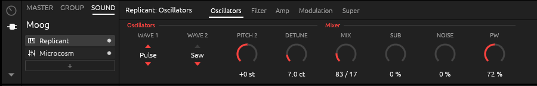

Replicant is a classic subtractive synth:

- **Oscillators:** two of them (saw, pulse, triangle or sine), a sub oscillator and
  noise.
- **Filter:** a resonant filter (low-pass, band-pass or high-pass) with its own
  envelope.
- **Amp and modulation:** an amp envelope, an LFO to pitch and cutoff, and vibrato on
  the mod wheel.
- **Voices:** 16, or Mono with glide. Stereo spread and analog-style drift.
- **Super page:** turns oscillator 1 into a JP-8000-style supersaw, with up to seven
  detuned copies, their detune and their mix.

Its pages are Oscillators, Filter, Amp, Modulation and Super. Add it from **+ ▸
Internal ▸ Replicant**.

### Plaits

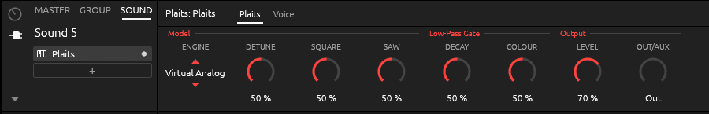

Plaits is Mutable Instruments' macro-oscillator module, built into DECKARD from Émilie
Gillet's open-source code, so it sounds like the module.

- **Engines:** all 24, including virtual analogue, waveshaping, FM, grains, additive,
  wavetables, chords, speech, strings, modal resonators and the drum models.
- **Knobs:** Harmonics, Timbre and Morph take the names the module's manual gives them
  for the engine chosen. For example, Virtual Analog shows Detune, Square and Saw.
- **Envelope:** the module's low-pass gate (Decay, Colour), or a plain gate with a
  Release.
- **Voices:** 1, 2, 4 or 8.

Plaits' code is © Emilie Gillet and used under the MIT licence; the licence is shown in
DECKARD's About box. Add it from **+ ▸ Internal ▸ Plaits**.

Replicant and Plaits are saved in the project like plug-ins, so the project still opens
in Maschine. Maschine can't play them and reports them as missing plug-ins. In DECKARD's
tests it kept their settings when it re-saved the project.

## More

- **Sampling:** record from your audio input, then edit, slice, map zones and
  time-stretch. **Stems** splits a sample into drums, bass, vocals and the rest. The
  model it needs (84 MB) downloads the first time you use it.
- **Note Repeat and Arpeggiator, scales and chords, Euclidean patterns, Lock snapshots
  and Macros**, as in Maschine.
- **Ableton Link and MIDI clock:** LINK in the header shares tempo and start/stop with
  other apps on your network. MIDI clock can be sent or followed (Preferences ▸ MIDI ▸
  Sync).
- **Browser** (F4): your Maschine library, if Maschine 3 is installed, and DECKARD's
  own.
- **Undo history:** **Edit ▸ Undo History** jumps back up to 30 steps at once.
- **Plug-ins:** DECKARD loads the VST3 plug-ins a project uses,
  and the VST2 plug-ins that have a VST3 version. Each one is restored to the state
  Maschine saved, and you can open its own window. Audio Units (macOS) are listed but
  not loaded yet. DECKARD's built-in instruments and effects work everywhere.
  - **Linux:** plug-ins are looked for in `~/.vst3` and the system's `vst3` folders.
    NI's plug-ins have no Linux versions; with [yabridge](https://github.com/robbert-vdh/yabridge)
    their Windows versions appear in `~/.vst3/yabridge` and load like any other.
    Plug-in windows are X11 windows (through XWayland on a Wayland desktop).
  - **Windows:** plug-ins are looked for in `Common Files\VST3`, system-wide and per
    user.
- **File compatibility:** DECKARD reads and writes Maschine projects, groups, sounds
  and presets. Projects it saves open in Maschine 3, and files it doesn't change are
  written back byte for byte.

## For developers

Building from source, the workspace layout, the command-line tools and the testing
conventions are in [DEVELOPMENT.md](DEVELOPMENT.md).

## Legal

DECKARD is not affiliated with or endorsed by Native Instruments. Maschine is a
trademark of Native Instruments GmbH. NI's controller scripts, style sheets, pictures
and library content are read from your own Maschine install when you have one, and are
not part of DECKARD.

DECKARD includes Ableton Link, which is licensed under the GPL (version 2 or later). A
DECKARD built with Link is distributed under the GPL, as the About box says. Plaits'
code is Mutable Instruments' (MIT licence).
